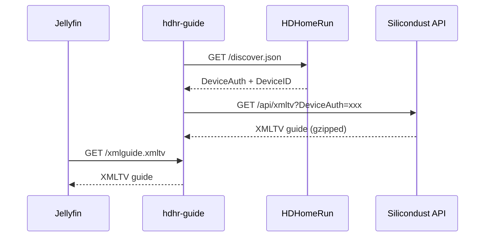

# HDHR Guide

A lightweight Docker container that queries a [HDHomeRun](https://www.silicondust.com/) tuner for its DeviceAuth, downloads the XMLTV guide from the [Silicondust API](https://github.com/Silicondust/documentation/wiki/XMLTV-Guide-Data), and serves it over HTTP for use with media servers like [Jellyfin](https://jellyfin.org/).

## Features

- **Zero config beyond the HDHomeRun URL** — just point it at your tuner
- **Auto-refreshes** the guide every 12 hours (configurable) with random jitter as required by the API
- **Always up-to-date DeviceAuth** — queries your HDHomeRun before each guide pull
- **2 days of guide data** for free, 14 days with an HDHomeRun DVR subscription
- **Tiny footprint** — ~50 MB Alpine-based image

## Quick Start

### 1. Add the service to your Jellyfin `docker-compose.yml`

Add this service alongside your existing Jellyfin container:

```yaml
services:
  # ... your existing jellyfin, sonarr, radarr, etc. ...

  hdhr-guide:
    image: ghcr.io/wildium/hdhr-guide:latest
    container_name: hdhr-guide
    restart: unless-stopped
    environment:
      - HDHR_URL=${HDHR_URL}
      - PORT=${HDHR_GUIDE_PORT:-9000}
      - REFRESH_HOURS=${HDHR_GUIDE_REFRESH_HOURS:-12}
```

### 2. Set your `.env` variables

Add these to your existing `.env` file (or create one next to your `docker-compose.yml`):

```ini
# Required: your HDHomeRun tuner URL
HDHR_URL=http://192.168.4.34/discover.json

# Optional overrides
# HDHR_GUIDE_PORT=9000
# HDHR_GUIDE_REFRESH_HOURS=12
```

> **Find your HDHomeRun URL:** Open `http://hdhomerun.local/discover.json` in a browser, or use the IP directly. The response will contain your `DeviceID` and `DeviceAuth`.

### 3. Start it

```bash
docker compose up -d hdhr-guide
```

The guide is served at `http://hdhr-guide:9000/xmlguide.xmltv` — accessible to any container on the same Docker network.

### 4. Configure Jellyfin

1. Go to **Dashboard → Live TV**
2. Under **Guide Data Providers**, add a new provider of type **XmlTV**
3. Set the **XMLTV URL** to:
   ```
   http://hdhr-guide:9000/xmlguide.xmltv
   ```
4. Click **Refresh Guide Data**

> A standalone [`docker-compose-example.yml`](docker-compose-example.yml) is also included if you prefer to run it independently.

## Environment Variables

| Variable | Required | Default | Description |
|---|---|---|---|
| `HDHR_URL` | **Yes** | — | Full URL to your HDHomeRun's `discover.json` (e.g., `http://192.168.4.34/discover.json`) |
| `HDHR_GUIDE_PORT` | No | `9000` | Internal HTTP port the guide is served on |
| `HDHR_GUIDE_REFRESH_HOURS` | No | `12` | How often to refresh the guide data (in hours). DeviceAuth is valid 16–24 hours, so values between 6–20 are recommended. |

## How It Works



## License

MIT
